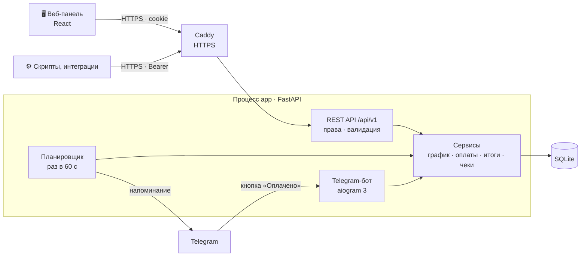
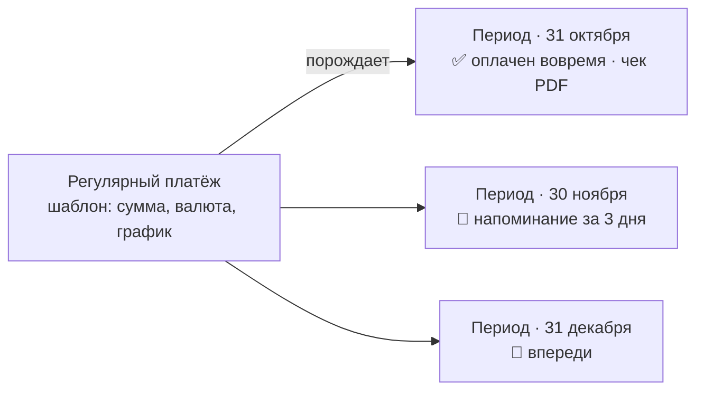

<div align="center">

# Invoice Keeper

**Не даёт забыть об аренде, серверах, подписках и других регулярных платежах.**

Администратор заводит платежи → бот заранее пишет в Telegram-чат → команда отмечает оплату
в панели или кнопкой прямо в сообщении → просрочки и итоги по валютам видны сразу.


[Быстрый старт](#-быстрый-старт) · [Развёртывание](docs/DEPLOY.md) · [Архитектура](docs/ARCHITECTURE.md) · [API](docs/API.md) · [Сценарий демонстрации](#-сценарий-демонстрации)

</div>

---

## Содержание

* [Что умеет](#-что-умеет)
* [Карта системы](#-карта-системы)
* [Стек](#-стек)
* [Быстрый старт](#-быстрый-старт)
* [Развёртывание на сервере](#-развёртывание-на-сервере)
* [API за 1 минуту](#-api-за-1-минуту)
* [Сценарий демонстрации](#-сценарий-демонстрации)
* [Подключение Telegram](#-подключение-telegram)
* [Как система считает](#-как-система-считает)
* [Роли и права](#-роли-и-права)
* [Безопасность](#безопасность)
* [Переменные окружения](#-переменные-окружения)
* [Тесты и разработка](#-тесты-и-разработка)
* [Документация](#-документация)

### Состав решения

| Что требуется | Где лежит |
|---|---|
| Код | сервер — [`app/`](app/), веб-панель — [`web/`](web/) (собранная — в `app/static`), тесты — [`tests/`](tests/) |
| Инструкция запуска | [«Быстрый старт»](#-быстрый-старт): Docker одной командой или Python без Docker; подробно — [`docs/DEPLOY.md`](docs/DEPLOY.md) |
| `.env.example` без секретов | [`.env.example`](.env.example): все настройки с пояснениями, пароли и токены не заполнены |
| Тестовые данные | загружаются сами при первом запуске, от сегодняшней даты — см. [«Сценарий демонстрации»](#-сценарий-демонстрации); код — [`app/seed.py`](app/seed.py) |
| OpenAPI и Swagger | [`openapi.yaml`](openapi.yaml) и `/api/v1/docs` в запущенном приложении; справочник с примерами — [`docs/API.md`](docs/API.md) |
| Архитектура | [`docs/ARCHITECTURE.md`](docs/ARCHITECTURE.md): карта, модель данных, напоминания, решения |
| Развёртывание кодом | [`ansible/`](ansible/): роль Ansible — любое число серверов, идемпотентно |
| Установка вручную | [`deploy-kit/`](deploy-kit/): установщик одним файлом с мастером и руководством администратора |

---

## ✨ Что умеет

| | |
|---|---|
| 🔔 **Напоминания в Telegram** | за N дней до срока (по умолчанию 3, общее окно и своё у каждого платежа), один раз на период, без дублей, с кнопкой **«✅ Оплачено»** |
| 📅 **Периоды** | у каждого месяца свой срок, отметка об оплате, фактическая дата, чек и комментарий; история не теряется |
| ⏰ **Просрочки** | вычисляются из срока и даты оплаты: «просрочено 5 дней», «оплачено с опозданием 2 дня» |
| 💱 **Валюты** | RUB, USD, EUR — итоги всегда раздельно, без конвертации |
| 🧾 **Чеки** | ссылка или файл (PDF, PNG, JPG, WebP до 10 МБ) — открывается прямо из строки оплаты |
| 🗂️ **Категории** | группы «Офис», «Серверы», «Подписки»; групповое прекращение, возобновление и перенос |
| 🗓️ **Календарь и бюджет** | реальные и плановые сроки на месяц и год, по валютам |
| 📜 **Журнал** | входы, оплаты, напоминания, чеки и настройки: кто, когда, с какого IP — с раскрытием подробностей |
| 🔐 **Роли** | один суперадмин из `.env` и пользователи; права проверяются на сервере |
| 🌗 **Панель** | светлая и тёмная темы, адаптивная вёрстка для телефона |

---

## 🗺️ Карта системы

Один процесс `app` содержит API, веб-панель, планировщик напоминаний и Telegram-бота. На сервере перед ним
стоит Caddy (HTTPS), данные — в одном файле SQLite. Подробно, со схемой данных и диаграммами — в
[**docs/ARCHITECTURE.md**](docs/ARCHITECTURE.md).





---

## 🧱 Стек

| Слой | Технологии |
|---|---|
| Сервер | **Python 3.12**, **FastAPI**, Uvicorn, **Pydantic 2**, pydantic-settings |
| Данные | **SQLite** (WAL), **SQLAlchemy 2.0**, **Alembic** — миграции применяются при старте |
| Telegram | **aiogram 3**: polling, inline-кнопки, обновление отправленных сообщений |
| Веб-панель | **React 19**, **Mantine 9**, TanStack Query 5, openapi-fetch, Vite 8, TypeScript |
| Контракт | OpenAPI из кода → `openapi.yaml` → типы TypeScript (`openapi-typescript`) |
| Инфраструктура | Docker, Docker Compose v2, **Caddy 2** (Let's Encrypt), **Ansible**, systemd-таймеры |
| Тесты | pytest + TestClient — 99 тестов |

Почему так, а не иначе (один процесс, SQLite, периоды как записи, атомарные напоминания, файлы в базе…) —
таблица решений в [docs/ARCHITECTURE.md](docs/ARCHITECTURE.md#8-ключевые-решения).

---

## 🚀 Быстрый старт

### Вариант 1. Docker (рекомендуется)

Нужен Docker с Compose v2.

```bash
cp .env.example .env          # при желании задайте ADMIN_PASSWORD и токен бота
docker compose up -d --build
```

Откройте **http://localhost:8080** — веб-панель, **http://localhost:8080/api/v1/docs** — Swagger.

### Вариант 2. Без Docker

Нужен Python **3.12+**. Node.js **не нужен**: собранная панель уже лежит в `app/static`.

Linux / macOS:

```bash
cp .env.example .env
python3 -m venv .venv
source .venv/bin/activate
pip install -r requirements.txt
python -m app
```

Windows (PowerShell):

```powershell
Copy-Item .env.example .env
py -3.12 -m venv .venv
.venv\Scripts\Activate.ps1
pip install -r requirements.txt
python -m app
```

При первом запуске приложение само создаёт базу (`data/invoice-keeper.db`), применяет миграции,
создаёт администратора из `.env` и загружает демо-данные.

### Учётные записи

| Роль | Логин | Пароль |
|---|---|---|
| Администратор | `ADMIN_LOGIN` из `.env` (по умолчанию `admin`) | `ADMIN_PASSWORD` из `.env` (в примере — `change-me`) |
| Пользователь | `user` | `user12345` |
| Пользователь | `accountant` | `accountant123` |

Пользователи `user` и `accountant` — тестовые, создаются вместе с демо-данными (`app/seed.py`).
Их пароли можно переопределить в `.env` (`DEMO_USER_PASSWORD`, `DEMO_ACCOUNTANT_PASSWORD`).
Администратор существует только в `.env`: через панель и API его не изменить и не удалить.

---

## 🌐 Развёртывание на сервере

Три способа, результат одинаковый: Docker, HTTPS через Caddy (свой домен или `IP.sslip.io`), база на Docker-томе,
миграции при обновлении применяются сами. **Пошагово, с проверкой, обновлением, копиями и решением проблем —
[docs/DEPLOY.md](docs/DEPLOY.md).**

| | [**Ansible**](docs/DEPLOY.md#5-ansible--инфраструктура-кодом) | [Установщик `.run`](docs/DEPLOY.md#6-установщик-одним-файлом) | [Docker Compose](docs/DEPLOY.md#7-docker-compose-вручную) |
|---|---|---|---|
| Для чего | серверы кодом, несколько экземпляров | один сервер с мастером в терминале | свой процесс деплоя |
| Секреты | Ansible Vault → `.env` (600) | мастер открывает `.env` | `.env` вручную |
| Ночные копии, команда `invoice-keeper` | ✅ | ✅ | — |
| Повторный запуск | `changed=0`, обновление с копией базы | обновление с сохранением данных | `git pull` + `up --build` |

```bash
# Ansible: с управляющей машины (Linux, macOS, WSL)
cd ansible
ansible-galaxy collection install -r requirements.yml
cp inventory.example.yml inventory.yml && cp group_vars/invoice_keeper/vault.yml.example group_vars/invoice_keeper/vault.yml
ansible-vault encrypt group_vars/invoice_keeper/vault.yml
ansible-playbook site.yml --ask-vault-pass
```

```bash
# Установщик: на сервере
scp deploy-kit/invoice-keeper-1.6.0.run root@IP_СЕРВЕРА: && ssh root@IP_СЕРВЕРА
bash invoice-keeper-1.6.0.run
```

```bash
# Docker Compose: на сервере, в .env — DOMAIN, COOKIE_SECURE=true, ADMIN_*, TELEGRAM_*
docker compose -f docker-compose.yml -f docker-compose.prod.yml up -d --build
```

> Роль Ansible и установщик берут код из релиза `deploy-kit/invoice-keeper-<версия>.run`. После изменений
> в коде пересоберите его: `scripts/build-installer.sh`.

---

## ⚡ API за 1 минуту

Всё, что умеет панель, доступно через REST API `/api/v1` — с теми же правами и журналом. Swagger UI —
**`/api/v1/docs`** (кнопка **Authorize**). Полный справочник с параметрами, ошибками, сценариями и примерами
на Python и JavaScript — [**docs/API.md**](docs/API.md).

```bash
BASE=http://localhost:8080/api/v1
TOKEN=$(curl -s -X POST $BASE/auth/login -H 'Content-Type: application/json' \
  -d '{"login":"user","password":"user12345"}' | python3 -c 'import sys,json; print(json.load(sys.stdin)["token"])')

# что не оплачено и просрочено
curl -s "$BASE/payment-occurrences?status=unpaid&overdue=true" -H "Authorization: Bearer $TOKEN"

# отметить оплату с комментарием
curl -s -X PATCH $BASE/payment-occurrences/8 -H "Authorization: Bearer $TOKEN" \
  -H 'Content-Type: application/json' -d '{"paid": true, "comment": "Оплачено с карты офиса"}'

# итоги по валютам за месяц
curl -s "$BASE/payments/summary?from=2026-10-01&to=2026-10-31" -H "Authorization: Bearer $TOKEN"
```

| Группа | Эндпоинты | Кто |
|---|---|---|
| Вход | `POST /auth/login` · `GET /auth/me` · `POST /auth/logout` · `GET /meta` | все |
| Регулярные платежи | `GET` `POST /recurring-payments` · `GET` `PATCH` `DELETE /recurring-payments/{id}` · `POST /recurring-payments/{id}/restore` | изменение — админ |
| Групповые действия | `POST /recurring-payments/bulk/stop` · `/bulk/restore` · `/bulk/category` | админ |
| Платежи (периоды) | `GET /payment-occurrences` (фильтры `status`, `overdue`, `currency`, `category_id`, `from`, `to`…) · `GET` `PATCH /payment-occurrences/{id}` | все |
| Файл чека | `PUT` `GET` `DELETE /payment-occurrences/{id}/receipt-file` | все |
| Итоги и бюджет | `GET /payments/summary` · `GET /payments/forecast` | все |
| Категории | `GET` `POST /categories` · `PATCH` `DELETE /categories/{id}` | изменение — админ |
| Настройки | `GET` `PATCH /settings` — окно напоминания, загрузка файлов | изменение — админ |
| Пользователи и журнал | `GET` `POST /users` · `GET` `PATCH` `DELETE /users/{id}` · `GET /audit-log` | админ |

Ошибки — одним форматом `{"error": {"code": "…", "message": "…", "details": …}}`:
401, 403, 404, 409, 413, 415, 422, 429 — расшифровка кодов в [docs/API.md](docs/API.md#3-ошибки).

---

## 🎬 Сценарий демонстрации

Демо-данные строятся **от текущей даты**, поэтому сценарий работает в любой день:

| Платёж | Валюта | Что показывает |
|---|---|---|
| Аренда офиса | RUB | срок 31-го числа → в 30-дневных месяцах 30-е; оплата в день срока — **вовремя** |
| VPS-сервер (Hetzner) | USD | срок через 2 дня → **напоминание уходит сразу после запуска** |
| Подписка Figma | EUR | текущий период **просрочен на 5 дней**, прошлый оплачен **с опозданием на 2 дня** |
| Домен invoice-keeper.ru | RUB | ежегодный платёж |
| Старый хостинг | USD | **прекращённый** платёж: история оплат видна, напоминаний нет |

1. **Войти администратором** (`admin`).
2. **Добавить регулярный платёж**: «Регулярные платежи» → «Добавить платёж», срок — через 1–3 дня.
3. **Получить напоминание в Telegram** — оно уходит сразу, потому что до срока меньше 3 дней.
4. **Войти пользователем** (`user` / `user12345`) и **отметить оплату** — кнопкой «Оплачено» в панели
   или прямо в Telegram.
5. **Просроченный платёж** — «Подписка Figma» на главной и во вкладке «Платежи → Просроченные».
6. **Исправить фактическую дату оплаты** — прошлый период Figma оплачен с опозданием на 2 дня:
   «Платежи» → кружок-отметка → «Изменить: дата, чек, комментарий» → дата срока → просрочка исчезает, срок не меняется.
7. **Следующий период с отдельным статусом** — после оплаты текущего периода в списке остаётся
   следующий, со своим сроком и статусом «Не оплачено»; прошлые оплаты сохраняются.

Вернуть демо-данные в исходное состояние:

```bash
python -m app reset-db                              # без Docker
docker compose exec app python -m app reset-db      # Docker
```

---

## 🤖 Подключение Telegram

1. Создайте бота у [@BotFather](https://t.me/BotFather) (`/newbot`) и скопируйте токен в `TELEGRAM_BOT_TOKEN`.
2. Перезапустите приложение, добавьте бота в нужный чат (группу) и отправьте в чате команду **`/chatid`** —
   бот ответит числом (для групп оно отрицательное).
3. Впишите это число в `TELEGRAM_CHAT_ID` и перезапустите приложение.

```bash
docker compose up -d          # Docker: перечитать .env
# или Ctrl+C и снова  python -m app
```

Без токена приложение работает полностью, только не отправляет напоминания (в панели администратора
показывается предупреждение). Если api.telegram.org недоступен, задайте `TELEGRAM_PROXY`.

> Один токен бота может одновременно получать обновления только в одном процессе. Если запускаете
> приложение в двух местах (локально и на сервере) — используйте разных ботов или `TELEGRAM_POLLING=false`.

Команды бота: `/upcoming` — что и когда оплатить в ближайшие 30 дней, `/chatid` — id чата, `/help`.
Под каждым напоминанием есть кнопка **«✅ Оплачено»**: она отмечает оплату сегодняшней датой,
обновляет сообщение и записывает в журнал, кто нажал.

---

## 🧮 Как система считает

**Регулярный платёж** — шаблон: название, сумма, валюта, дата ближайшей оплаты, периодичность
(ежемесячно — обязательно; дополнительно еженедельно, ежеквартально, ежегодно).

**Период** — отдельная запись `payment_occurrence`: свой срок, своя отметка «Оплачено / Не оплачено»,
своя фактическая дата и своё напоминание. Новый период не стирает прошлые, просрочка не останавливает
следующие.

* **Сроки** считаются от исходной даты, а не от предыдущего срока: 31.01 → 28.02 (29.02) → **31.03**.
  Если числа в месяце нет — последний день месяца.
* **Какие периоды существуют:** все со сроком не позже «сегодня + окно напоминания» и ещё один следующий
  (если он оплачен заранее — ещё один). Поэтому следующий период всегда виден в списке.
* **Единый часовой пояс** — `APP_TIMEZONE`. Все даты — календарные (`YYYY-MM-DD`) в этом поясе.
* **Оплачено** — указана фактическая дата (по умолчанию сегодня). Дата **не может быть в будущем**.
  Отмена отметки очищает дату.
* **Просрочка не хранится, а вычисляется:** не оплачено и сегодня позже срока, либо оплачено позже срока.
  Просрочка — со следующего дня после срока, оплата в день срока — вовремя. Исправили фактическую дату —
  просрочка пересчиталась, срок не изменился.
* **Напоминание** — один раз на каждый неоплаченный период, не позже чем за N дней до срока.
  N — своё окно платежа, если его задали в карточке платежа, иначе общее окно из раздела «Настройки»
  (по умолчанию `REMINDER_DAYS_BEFORE` = 3, допустимо от 3 до 365). Окно увеличили — напоминания о попавших
  в него сроках уйдут при ближайшей проверке. Добавили платёж позже — напоминание уходит сразу. Оплаченный
  период не напоминается. Если у платежа сразу несколько неоплаченных периодов (заведён задним числом), они
  приходят **одним** сообщением. Защита от дублей — атомарная отметка периода в БД перед отправкой
  (`UPDATE … WHERE reminder_sent_at IS NULL`), поэтому ни повторная проверка, ни перезапуск дубля не дают.
  Если Telegram недоступен, отметка снимается и отправка повторяется на следующей проверке (каждые 60 с).
* **Редактирование** (администратор): название, сумма и валюта меняются у шаблона и у неоплаченных
  периодов со сроком от сегодня; оплаченные и прошлые периоды — история, они не меняются.
  Смена даты или периодичности пересоздаёт будущие неоплаченные периоды по новому графику.
* **Удаление** — это прекращение: новых периодов и напоминаний нет, будущие неоплаченные периоды
  удаляются, история оплат остаётся (с пометкой «прекращён»).
* **Возобновление:** прекращённый платёж можно вернуть. График продолжается с сегодняшнего дня, сроки
  за время паузы задним числом не создаются — иначе возобновление сразу дало бы пачку просрочек.
  Прекращать, возобновлять и переносить в категорию можно и несколько платежей сразу: всё или ничего —
  если какого-то платежа нет, не меняется ни один.
* **Валюты** RUB, USD, EUR — суммы всегда отдельно, без конвертации. Суммы хранятся в копейках/центах.
* **Итоги** (`/payments/summary`): `paid` — фактические оплаты (фильтр `from/to` — по дате оплаты),
  `unpaid` и `overdue` — неоплаченные периоды (фильтр — по сроку).

---

## 👥 Роли и права

| | Пользователь | Администратор |
|---|:-:|:-:|
| Видеть платежи, итоги, календарь | ✅ | ✅ |
| Отмечать / отменять оплату, исправлять фактическую дату | ✅ | ✅ |
| Прикреплять к оплате чек (ссылку или файл) и комментарий | ✅ | ✅ |
| Создавать, изменять, прекращать и возобновлять регулярные платежи | ❌ 403 | ✅ |
| Создавать, переименовывать, удалять категории платежей | ❌ 403 | ✅ |
| Менять настройки: окно напоминания, загрузка файлов | ❌ 403 | ✅ |
| Создавать, изменять, удалять пользователей | ❌ 403 | ✅ |
| Журнал действий | ❌ 403 | ✅ |

Ограничения проверяются на сервере (зависимость `require_admin`), а не только скрываются в интерфейсе.
Без авторизации все эндпоинты, кроме входа и документации, отвечают **401** — это проверяет тест,
который перебирает все операции из OpenAPI.

## Безопасность

* **SQL-инъекции.** Все запросы к БД строятся через SQLAlchemy с параметрами — ни одного SQL, собранного
  из строк. Входные данные проверяются Pydantic: даты, числа, валюты и id — строго типизированы,
  в поиске по журналу символы `%` и `_` экранируются. Тесты подставляют типовые инъекции
  (`' OR '1'='1`, `'; DROP TABLE users; --`) в логин, фильтры, названия и проверяют, что они сохраняются
  как обычный текст, а таблицы целы.
* **XSS.** API отдаёт только JSON; панель на React экранирует весь выводимый текст (без `innerHTML`).
  Строгая политика CSP: скрипты только с собственного домена, без inline-скриптов. Ссылка на чек принимается
  только `http(s)` (сервер) и дополнительно проверяется в браузере — `javascript:`-ссылку не подставить.
  В сообщениях Telegram (HTML-разметка) все пользовательские данные экранируются. Управляющие символы
  в названиях запрещены.
* **CSRF.** Cookie сессии — `HttpOnly`, `SameSite=Lax` (и `Secure` за HTTPS); изменяющие запросы с cookie
  принимаются только со своего сайта (проверка `Origin`). Bearer-токен браузер сам не подставляет.
* **Пароли и сессии.** Пароли — `scrypt` с солью; в БД хранится только SHA-256 токена сессии.
  Смена пароля и удаление пользователя завершают его сессии. Неудачные входы ограничены
  (10 попыток за 5 минут с одного IP) и пишутся в журнал.
* **Файлы чеков.** Принимаются только PDF, PNG, JPG и WebP. Тип определяется по содержимому (сигнатуре
  файла), а не по имени или заголовку от браузера, и расширение должно ему соответствовать: программа,
  переименованная в `.pdf`, отклоняется. Скрипты, архивы, HTML и SVG не принимаются; PDF со скриптами
  (`/JavaScript`), запуском программ (`/Launch`), вложениями и формами XFA — тоже. Размер — не больше
  `UPLOAD_MAX_MB` (10 МБ): тело запроса читается частями и обрывается на пределе. Имя файла очищается от пути
  и управляющих символов и передаётся в заголовке, а не в адресе (адреса пишутся в журналы). Сервер файл не
  запускает и не разбирает: он хранится в базе как набор байтов (поэтому попадает в резервные копии) и
  отдаётся с жёстким `Content-Type`, `nosniff` и запрещающей CSP, картинки — в «песочнице». Загрузку
  можно отключить в «Настройках».
* **Заголовки.** `Content-Security-Policy`, `X-Frame-Options: DENY`, `X-Content-Type-Options: nosniff`,
  `Referrer-Policy`, `Cache-Control: no-store` для ответов API; на сервере — HSTS (Caddy).

---

## ⚙️ Переменные окружения

| Переменная | По умолчанию | Описание |
|---|---|---|
| `ADMIN_LOGIN` / `ADMIN_PASSWORD` | `admin` / — | Единственный администратор (обязательно задать пароль) |
| `APP_TIMEZONE` | `Europe/Moscow` | Единый часовой пояс для всех дат |
| `DATABASE_URL` | `sqlite:///./data/invoice-keeper.db` | База данных (SQLAlchemy URL) |
| `TELEGRAM_BOT_TOKEN` | — | Токен бота |
| `TELEGRAM_CHAT_ID` | — | Чат для напоминаний (узнать — командой `/chatid`) |
| `TELEGRAM_PROXY`, `TELEGRAM_API_URL` | — | Прокси и свой адрес Bot API (необязательно) |
| `TELEGRAM_POLLING` | `true` | Принимать команды и нажатия кнопок |
| `PUBLIC_URL` | — | Публичный адрес панели — для кнопки «Открыть в панели» в сообщениях бота |
| `REMINDER_DAYS_BEFORE` | `3` | За сколько дней напоминать по умолчанию (3–365); дальше администратор меняет это в «Настройках» |
| `REMINDER_CHECK_INTERVAL_SECONDS` | `60` | Как часто проверять сроки |
| `UPLOAD_MAX_MB` | `10` | Предельный размер файла чека, МБ (1–50) |
| `SESSION_TTL_HOURS` | `168` | Время жизни сессии |
| `COOKIE_SECURE` | `false` | `true` при работе по HTTPS |
| `SEED_DEMO_DATA` | `true` | Загрузить демо-данные в пустую базу |
| `DEMO_USER_PASSWORD`, `DEMO_ACCOUNTANT_PASSWORD` | `user12345`, `accountant123` | Пароли демо-пользователей (на сервере — свои) |
| `HOST`, `PORT` | `0.0.0.0`, `8080` | Адрес веб-сервера |
| `DOMAIN` | — | Домен для HTTPS (только `docker-compose.prod.yml`) |

> Docker Compose подставляет переменные вместо `$` в значениях `.env` и отрезает ` #комментарий`.
> Если в пароле или токене есть `$`, `#` или пробел — возьмите значение в одинарные кавычки:
> `ADMIN_PASSWORD='Pa$s #1'`. Установщик и роль Ansible делают это сами.

---

## 🧪 Тесты и разработка

```bash
pip install -r requirements-dev.txt
pytest
```

99 тестов: графики (31-е число, 29 февраля, годовые), просрочка (оплата в день срока), права
(401 на всех эндпоинтах без входа, 403 на всех админских для пользователя, неизменяемый админ),
оплата / отмена / исправление даты, дата в будущем, следующий период, прекращение и возобновление
платежа без «просрочек задним числом», групповые действия, итоги по валютам, напоминания (за 3 дня, сразу,
без дублей, после перезапуска, повтор при ошибке Telegram), общее и своё окно напоминания, файлы чеков
(подмена расширения, PDF со скриптами, размер, отключение загрузки), комментарии и категории,
миграции без потери истории оплат, сохранность данных после перезапуска, SQL-инъекции, XSS, CSRF
и заголовки безопасности.

Веб-панель:

```bash
cd web
npm install
npm run dev        # http://localhost:5173, запросы /api проксируются на :8080
npm run gen:api    # типы TypeScript из ../openapi.yaml
npm run build      # сборка в app/static
```

После изменения API: `python -m app export-openapi` → `npm run gen:api`.

---

## 📚 Документация

| Документ | О чём |
|---|---|
| [**docs/DEPLOY.md**](docs/DEPLOY.md) | развёртывание: выбор способа, Ansible, установщик, Docker Compose, проверка, обновление, копии, проблемы |
| [**docs/ARCHITECTURE.md**](docs/ARCHITECTURE.md) | карта системы, стек, модель данных, жизненный цикл периода, напоминания, ключевые решения |
| [**docs/API.md**](docs/API.md) | REST API: авторизация, ошибки, все эндпоинты, сценарии, клиенты на Python, JavaScript, TypeScript |
| [ansible/README.md](ansible/README.md) | роль Ansible: переменные, теги, откат, несколько экземпляров |
| [deploy-kit/README.md](deploy-kit/README.md) | руководство администратора сервера: мастер, команда `invoice-keeper`, копии, перенос |
| [web/DESIGN.md](web/DESIGN.md) | правила интерфейса: стекло, отступы, типографика, движение |
| [openapi.yaml](openapi.yaml) | спецификация OpenAPI 3.1 |
