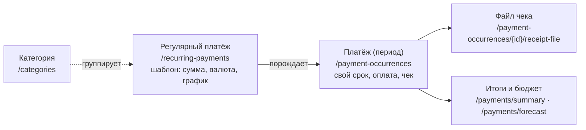
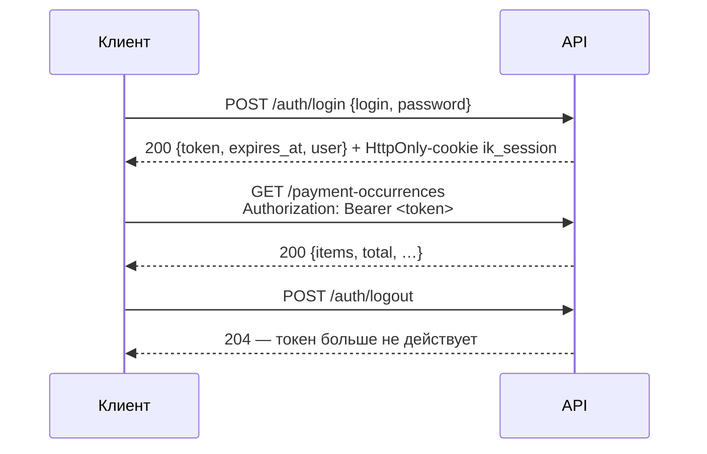
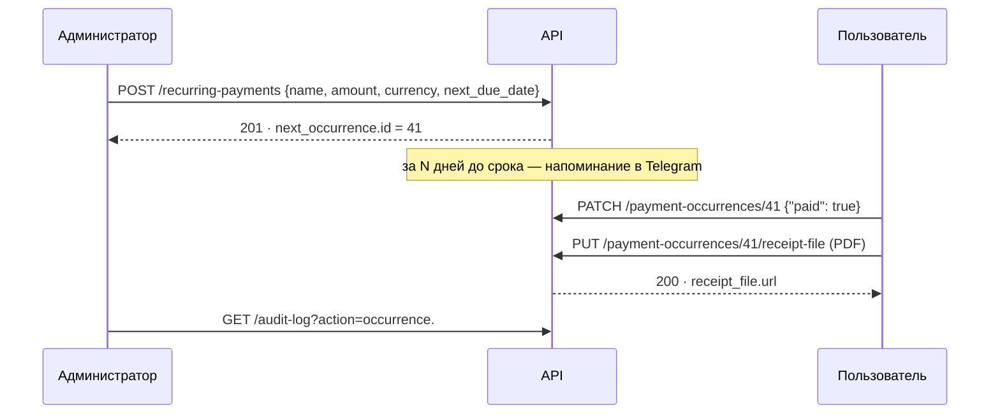

# REST API Invoice Keeper

> Всё, что умеет веб-панель, доступно через API `/api/v1`: те же правила, права и журнал действий.
> Интерактивная документация — **Swagger UI** на `/api/v1/docs` запущенного приложения,
> машиночитаемая спецификация — [`openapi.yaml`](../openapi.yaml) и `/api/v1/openapi.json`.

## Содержание

1. [Основы](#1-основы)
2. [Авторизация](#2-авторизация)
3. [Ошибки](#3-ошибки)
4. [Справочник эндпоинтов](#4-справочник-эндпоинтов)
5. [Типовые сценарии](#5-типовые-сценарии)
6. [Примеры клиентов](#6-примеры-клиентов)
7. [Значения перечислений](#7-значения-перечислений)

---

## 1. Основы

| | |
|---|---|
| Базовый адрес | `https://ВАШ-ДОМЕН/api/v1` (локально — `http://localhost:8080/api/v1`) |
| Формат | JSON в UTF-8; файл чека — «сырое» тело запроса |
| Даты | календарные, `YYYY-MM-DD`, в часовом поясе приложения (`APP_TIMEZONE`); «сегодня» сервера — в `GET /meta` |
| Время | ISO 8601 с поясом, например `2026-10-25T03:08:20Z` |
| Деньги | **строкой** с двумя знаками: `"85000.00"` — без ошибок округления `float`; валюты не смешиваются |
| Страницы | списки с пагинацией возвращают `{"items": [...], "total": 42, "limit": 100, "offset": 0}` |
| Права | у каждого эндпоинта ниже указано: **все** (любой вошедший) или **админ** |



Ключевое различие: **регулярный платёж** — это шаблон («аренда, 85 000 ₽, ежемесячно 31-го»), а **платёж
(период)** — конкретный месяц со своим сроком, отметкой об оплате и чеком. Оплату отмечают у периода.

---

## 2. Авторизация



* **Скрипты и интеграции** передают токен в заголовке `Authorization: Bearer <token>`.
* **Веб-панель** использует HttpOnly-cookie той же сессии; изменяющие запросы с cookie принимаются только
  со своего сайта (проверка `Origin` — защита от CSRF). Bearer-токен браузер сам не подставляет.
* Срок жизни сессии — `SESSION_TTL_HOURS` (по умолчанию 168 часов = 7 дней). Смена пароля и удаление
  пользователя завершают его сессии.
* **10 неудачных входов за 5 минут** с одного IP → `429 too_many_attempts`.
* В Swagger UI — кнопка **Authorize**: вставьте токен, и запросы из документации пойдут от вашего имени.

```bash
BASE=http://localhost:8080/api/v1
TOKEN=$(curl -s -X POST $BASE/auth/login -H 'Content-Type: application/json' \
  -d '{"login":"user","password":"user12345"}' | python3 -c 'import sys,json; print(json.load(sys.stdin)["token"])')
AUTH="Authorization: Bearer $TOKEN"
```

> Примеры написаны для bash (Linux, macOS, WSL). В Git Bash под Windows кириллица в аргументах командной
> строки может испортиться — передавайте тело файлом: `curl … --data-binary @body.json`,
> или используйте PowerShell: `Invoke-RestMethod -Method Post -Uri $BASE/auth/login -ContentType 'application/json; charset=utf-8' -Body '{"login":"user","password":"user12345"}'`.

Ответ входа:

```json
{
  "token": "…",
  "token_type": "bearer",
  "expires_at": "2026-10-31T09:00:00+03:00",
  "user": { "id": 1, "login": "admin", "name": "Администратор", "role": "admin", "managed_by_env": true, "created_at": "…" }
}
```

---

## 3. Ошибки

Все ошибки — одного вида: `code` для программы, `message` для человека, `details` — подробности.

```json
{ "error": { "code": "validation_error", "message": "Некорректные данные запроса",
             "details": [ { "field": "amount", "message": "Input should be greater than 0" },
                          { "field": "currency", "message": "Input should be 'RUB', 'USD' or 'EUR'" } ] } }
```

| HTTP | `code` | Когда |
|---|---|---|
| 401 | `unauthorized` | нет токена, токен неверный или истёк; неверный логин или пароль |
| 403 | `forbidden` | действие только для администратора; запрос с cookie не со своего сайта |
| 403 | `uploads_disabled` | загрузка файлов чеков выключена в настройках |
| 404 | `not_found` | объекта нет; для групповых действий — `details.missing_ids` |
| 409 | `payment_stopped` | регулярный платёж прекращён — менять можно только категорию |
| 409 | `login_taken` | логин занят или совпадает с логином суперадмина |
| 409 | `category_exists` | категория с таким названием уже есть (без учёта регистра) |
| 409 | `not_paid` | файл чека прикрепляется только к оплаченному периоду |
| 413 | `file_too_large` | файл больше `UPLOAD_MAX_MB` |
| 415 | `unsupported_file_type` · `extension_mismatch` · `pdf_active_content` | не PDF/PNG/JPG/WebP · расширение не совпадает с содержимым · PDF со скриптами, вложениями, запуском программ |
| 422 | `validation_error` | тело или параметры не прошли проверку (`details` — по полям) |
| 422 | `paid_at_in_future` · `paid_at_with_unpaid` | дата оплаты в будущем · дата при отмене оплаты |
| 422 | `next_due_date_in_past` · `no_changes` | при смене графика дата в прошлом · пустой PATCH |
| 422 | `category_not_found` · `empty_file` | указана несуществующая категория · пустой файл |
| 422 | `invalid_range` · `range_too_large` | `from` позже `to` · диапазон календаря больше 400 дней |
| 429 | `too_many_attempts` | слишком много неудачных входов |

---

## 4. Справочник эндпоинтов

### 4.1. Вход и служебное

| Метод | Путь | Кто | Что делает |
|---|---|---|---|
| `POST` | `/auth/login` | — | вход: `{"login", "password"}` → токен (публичный эндпоинт) |
| `GET` | `/auth/me` | все | текущий пользователь |
| `POST` | `/auth/logout` | все | завершить текущую сессию → `204` |
| `GET` | `/meta` | все | «сегодня» по времени приложения, часовой пояс, окно напоминания, лимит файлов, статус Telegram |

```bash
curl -s $BASE/meta -H "$AUTH"
# {"today":"2026-10-24","timezone":"Europe/Moscow","reminder_days_before":3,"uploads_enabled":true,
#  "upload_max_mb":10,"currencies":["RUB","USD","EUR"],"frequencies":["weekly","monthly","quarterly","yearly"],
#  "telegram":{"bot_configured":true,"chat_configured":true,"bot_username":"invoice_keeper_bot"}}
```

### 4.2. Регулярные платежи

| Метод | Путь | Кто | Что делает |
|---|---|---|---|
| `GET` | `/recurring-payments` | все | список; `?include_deleted=true` — вместе с прекращёнными |
| `POST` | `/recurring-payments` | админ | создать → `201`; сразу создаются ближайшие периоды, при близком сроке уходит напоминание |
| `GET` | `/recurring-payments/{id}` | все | один платёж |
| `PATCH` | `/recurring-payments/{id}` | админ | изменить любые поля; меняются шаблон и будущие неоплаченные периоды, история — нет |
| `DELETE` | `/recurring-payments/{id}` | админ | **прекратить**: новых периодов и напоминаний нет, история остаётся → `204` |
| `POST` | `/recurring-payments/{id}/restore` | админ | возобновить: график продолжается с сегодня, сроки за паузу не создаются |
| `POST` | `/recurring-payments/bulk/stop` | админ | прекратить несколько: `{"ids": [1, 2, 3]}` |
| `POST` | `/recurring-payments/bulk/restore` | админ | возобновить несколько |
| `POST` | `/recurring-payments/bulk/category` | админ | перенести в категорию: `{"ids": [...], "category_id": 5}` (`null` — без категории) |

**Создание** (`RecurringPaymentCreate`):

| Поле | Тип | Обязательно | Описание |
|---|---|:-:|---|
| `name` | строка 1–200 | ✅ | название, без управляющих символов |
| `amount` | строка-число | ✅ | больше нуля, до 2 знаков после точки, не больше 10¹² |
| `currency` | `RUB` · `USD` · `EUR` | ✅ | валюта |
| `next_due_date` | дата | ✅ | дата ближайшей оплаты — от неё строится график (может быть в прошлом: прошлые сроки станут просроченными) |
| `frequency` | `weekly` · `monthly` · `quarterly` · `yearly` | | по умолчанию `monthly` |
| `remind_days` | 3–365 | | своё окно напоминания; не задано — общее из `/settings` |
| `category_id` | число | | категория из `/categories` |

```bash
curl -s -X POST $BASE/recurring-payments -H "$AUTH" -H 'Content-Type: application/json' -d '{
  "name": "Аренда офиса", "amount": "85000.00", "currency": "RUB",
  "next_due_date": "2026-10-31", "frequency": "monthly", "remind_days": 7
}'
```

Ответ (`RecurringPaymentOut`), сокращённо:

```json
{
  "id": 2, "name": "VPS-сервер (Hetzner)", "amount": "49.90", "currency": "USD", "frequency": "monthly",
  "anchor_date": "2026-09-26", "next_due_date": "2026-10-26",
  "next_occurrence": { "id": 5, "due_date": "2026-10-26", "state": "due_soon", "days_until_due": 2, "reminder_sent_at": null },
  "overdue_count": 0, "remind_days": null, "remind_days_effective": 3,
  "category_id": null, "category_name": null, "is_active": true, "deleted_at": null, "resumed_on": null
}
```

**Изменение** — передавайте только то, что меняется. `remind_days: null` возвращает общее окно,
`category_id: null` убирает из категории. Смена `next_due_date` или `frequency` пересоздаёт будущие
неоплаченные периоды по новому графику.

```bash
curl -s -X PATCH $BASE/recurring-payments/2 -H "$AUTH" -H 'Content-Type: application/json' -d '{"amount": "59.90"}'
```

**Групповые действия — «всё или ничего»:** если хотя бы одного id нет, ничего не меняется (`404`, `details.missing_ids`).
Ответ показывает, что изменилось, а что уже было в нужном состоянии:

```bash
curl -s -X POST $BASE/recurring-payments/bulk/stop -H "$AUTH" -H 'Content-Type: application/json' -d '{"ids": [2, 3]}'
# {"changed": [2], "unchanged": [3]}
```

### 4.3. Платежи (периоды) и оплата

| Метод | Путь | Кто | Что делает |
|---|---|---|---|
| `GET` | `/payment-occurrences` | все | список с фильтрами и пагинацией |
| `GET` | `/payment-occurrences/{id}` | все | один период |
| `PATCH` | `/payment-occurrences/{id}` | все | отметить или отменить оплату, исправить фактическую дату, ссылка на чек, комментарий |

**Фильтры списка:**

| Параметр | Значения | Описание |
|---|---|---|
| `status` | `paid` · `unpaid` | оплаченные или нет |
| `overdue` | `true` · `false` | с просрочкой: не оплачен после срока **или** оплачен позже срока |
| `currency` | `RUB` · `USD` · `EUR` | валюта |
| `recurring_payment_id` | число | периоды одного регулярного платежа |
| `category_id` | число, `0` | категория; `0` — без категории |
| `from`, `to` | дата | срок не раньше / не позже |
| `include_inactive` | `true` (по умолчанию) | включать периоды прекращённых платежей |
| `sort` | `due_date` · `-due_date` | по сроку вверх или вниз |
| `limit`, `offset` | 1–500 (100), ≥ 0 | пагинация |

```bash
curl -s "$BASE/payment-occurrences?status=unpaid&overdue=true&currency=EUR" -H "$AUTH"
```

Элемент списка (`OccurrenceOut`):

```json
{
  "id": 8, "recurring_payment_id": 3, "name": "Подписка Figma", "frequency": "monthly",
  "amount": "15.00", "currency": "EUR", "due_date": "2026-10-19",
  "status": "unpaid", "paid_at": null, "paid_by": null, "paid_via": null,
  "is_overdue": true, "overdue_days": 5, "days_until_due": -5, "state": "overdue",
  "reminder_sent_at": null, "receipt_url": null, "receipt_file": null, "comment": null,
  "category_id": null, "category_name": null, "payment_active": true
}
```

**Оплата** — одним `PATCH`:

| Тело | Что произойдёт |
|---|---|
| `{"paid": true}` | оплачено сегодня |
| `{"paid": true, "paid_at": "2026-10-20"}` | оплачено указанной датой (не позже сегодня) |
| `{"paid": false}` | отменить оплату — фактическая дата очищается |
| `{"paid_at": "2026-10-19"}` | исправить фактическую дату; срок не меняется, просрочка пересчитается |
| `{"receipt_url": "https://…"}` | ссылка на чек (только `http`/`https`); `null` — убрать |
| `{"comment": "…"}` | комментарий до 1000 символов, можно в несколько строк; `""` или `null` — убрать |

```bash
curl -s -X PATCH $BASE/payment-occurrences/8 -H "$AUTH" -H 'Content-Type: application/json' \
  -d '{"paid": true, "paid_at": "2026-10-24", "comment": "Оплачено с карты офиса"}'
# → "status": "paid", "state": "paid_late", "overdue_days": 5, "paid_via": "web",
#   "paid_by": {"user_id": 1, "label": "admin"}, "comment": "Оплачено с карты офиса"
```

Если бот уже присылал напоминание об этом сроке, сообщение в Telegram обновится — в нём будет видно, кто и когда оплатил.

### 4.4. Файл чека

| Метод | Путь | Кто | Что делает |
|---|---|---|---|
| `PUT` | `/payment-occurrences/{id}/receipt-file` | все | прикрепить или заменить файл |
| `GET` | `/payment-occurrences/{id}/receipt-file` | все | получить файл (открывается в браузере) |
| `DELETE` | `/payment-occurrences/{id}/receipt-file` | все | удалить файл с сервера → `204` |

* Тело запроса — **сам файл** (не multipart). Имя — в заголовке **`X-File-Name`**, закодированное как в URL
  (`encodeURIComponent`): в адрес имя не попадает, потому что адреса пишутся в журналы.
* Только **PDF, PNG, JPG, WebP** до `UPLOAD_MAX_MB` (10 МБ). Тип определяется по содержимому; расширение
  должно ему соответствовать. PDF со скриптами, вложениями или запуском программ отклоняется.
* Прикрепить можно только к **оплаченному** периоду. Администратор может выключить загрузку (`PATCH /settings`).
* В ответе `PUT` — обновлённый период: в поле `receipt_file` имя, тип, размер, `sha256`, кто загрузил и `url`.

```bash
curl -s -X PUT $BASE/payment-occurrences/8/receipt-file -H "$AUTH" \
  -H 'Content-Type: application/pdf' \
  -H "X-File-Name: $(python3 -c 'import urllib.parse;print(urllib.parse.quote("Чек ноябрь.pdf"))')" \
  --data-binary @"Чек ноябрь.pdf"

curl -s $BASE/payment-occurrences/8/receipt-file -H "$AUTH" -o receipt.pdf     # скачать
curl -s -X DELETE $BASE/payment-occurrences/8/receipt-file -H "$AUTH"            # удалить
```

### 4.5. Итоги, календарь и бюджет

| Метод | Путь | Кто | Что делает |
|---|---|---|---|
| `GET` | `/payments/summary` | все | итоги **по каждой валюте отдельно**: оплачено, не оплачено, просрочено |
| `GET` | `/payments/forecast` | все | календарь и бюджет: реальные периоды + плановые сроки по графикам, не больше 400 дней |

* `summary?from=&to=`: `paid` считается по **дате оплаты**, `unpaid` и `overdue` — по **сроку**. Без дат — за всё время.
* `forecast?from=&to=` (обязательны): у каждого срока `status` — `paid`, `unpaid` или `planned` (период ещё не создан,
  но по графику будет); итоги `planned` / `paid` / `remaining` — по валютам.

```bash
curl -s "$BASE/payments/summary?from=2026-10-01&to=2026-10-31" -H "$AUTH"
# {"today":"2026-10-24","currencies":[
#   {"currency":"RUB","paid":{"amount":"0.00","count":0},"unpaid":{"amount":"85000.00","count":1},"overdue":{"amount":"0.00","count":0}},
#   {"currency":"EUR","paid":{"amount":"0.00","count":0},"unpaid":{"amount":"15.00","count":1},"overdue":{"amount":"15.00","count":1}}, …]}

curl -s "$BASE/payments/forecast?from=2026-01-01&to=2026-12-31" -H "$AUTH"     # бюджет на год
```

### 4.6. Категории

| Метод | Путь | Кто | Что делает |
|---|---|---|---|
| `GET` | `/categories` | все | список с числом активных платежей в каждой |
| `POST` | `/categories` | админ | создать: `{"name": "Серверы"}` → `201` |
| `PATCH` | `/categories/{id}` | админ | переименовать |
| `DELETE` | `/categories/{id}` | админ | удалить; платежи остаются без категории → `204` |

```bash
curl -s -X POST $BASE/categories -H "$AUTH" -H 'Content-Type: application/json' -d '{"name": "Серверы"}'
# {"id": 1, "name": "Серверы", "payments_count": 0, "created_at": "…"}
```

### 4.7. Настройки

| Метод | Путь | Кто | Что делает |
|---|---|---|---|
| `GET` | `/settings` | все | окно напоминания, значение из `.env`, загрузка файлов и её лимит |
| `PATCH` | `/settings` | админ | `{"reminder_days_before": 5}` (3–365) и/или `{"uploads_enabled": false}` |

```bash
curl -s -X PATCH $BASE/settings -H "$AUTH" -H 'Content-Type: application/json' -d '{"reminder_days_before": 7}'
# {"reminder_days_before": 7, "reminder_days_default": 3, "uploads_enabled": true, "upload_max_mb": 10}
```

Окно увеличили — напоминания о попавших в него сроках уйдут при ближайшей проверке (в течение минуты).

### 4.8. Пользователи и журнал

| Метод | Путь | Кто | Что делает |
|---|---|---|---|
| `GET` · `POST` | `/users` | админ | список · создать пользователя `{"login", "password", "name"}` |
| `GET` · `PATCH` · `DELETE` | `/users/{id}` | админ | получить · изменить логин, имя, пароль · удалить (сессии завершаются) |
| `GET` | `/audit-log` | админ | журнал: `action` (префикс, например `occurrence.` или `auth.`), `actor`, `limit` ≤ 500, `offset` |

Суперадмин в этих эндпоинтах виден с `managed_by_env: true` и не изменяется: он задаётся только в `.env`.
Логины — 3–64 символа (`A–Z a–z 0–9 _ . -`), пароли — 6–128 символов.

```bash
curl -s "$BASE/audit-log?action=occurrence.&limit=20" -H "$AUTH"
# {"items":[{"id":19,"at":"…","actor_label":"admin","action":"occurrence.pay","entity":"payment_occurrence",
#            "entity_id":8,"details":{"due_date":"2026-10-19","to":"2026-10-24"},"ip":"203.0.113.5"}], "total": …}
```

---

## 5. Типовые сценарии

### Завести платёж и провести оплату с чеком



```bash
ID=$(curl -s -X POST $BASE/recurring-payments -H "$AUTH" -H 'Content-Type: application/json' \
  -d '{"name":"Хостинг","amount":"1200.00","currency":"RUB","next_due_date":"2026-11-05"}' \
  | python3 -c 'import sys,json; print(json.load(sys.stdin)["next_occurrence"]["id"])')
curl -s -X PATCH $BASE/payment-occurrences/$ID -H "$AUTH" -H 'Content-Type: application/json' -d '{"paid": true}'
curl -s -X PUT $BASE/payment-occurrences/$ID/receipt-file -H "$AUTH" -H 'X-File-Name: check.pdf' --data-binary @check.pdf
```

### Ежедневная выгрузка просрочек (например, для бухгалтерии)

```bash
curl -s "$BASE/payment-occurrences?overdue=true&status=unpaid&limit=500" -H "$AUTH" \
  | python3 -c 'import sys,json
for o in json.load(sys.stdin)["items"]:
    print(o["due_date"], o["name"], o["amount"], o["currency"], o["overdue_days"], sep=";")' > overdue.csv
```

### Разложить платежи по категориям и прекратить целую группу

```bash
CAT=$(curl -s -X POST $BASE/categories -H "$AUTH" -H 'Content-Type: application/json' -d '{"name":"Старые серверы"}' \
  | python3 -c 'import sys,json; print(json.load(sys.stdin)["id"])')
curl -s -X POST $BASE/recurring-payments/bulk/category -H "$AUTH" -H 'Content-Type: application/json' \
  -d "{\"ids\": [4, 7, 9], \"category_id\": $CAT}"
curl -s -X POST $BASE/recurring-payments/bulk/stop -H "$AUTH" -H 'Content-Type: application/json' -d '{"ids": [4, 7, 9]}'
```

### Бюджет на год по валютам

```bash
curl -s "$BASE/payments/forecast?from=2027-01-01&to=2027-12-31" -H "$AUTH" \
  | python3 -c 'import sys,json
for t in json.load(sys.stdin)["totals"]:
    print(t["currency"], "план", t["planned"]["amount"], "осталось", t["remaining"]["amount"])'
```

---

## 6. Примеры клиентов

### Python (httpx)

```python
import httpx

BASE = "http://localhost:8080/api/v1"

with httpx.Client(base_url=BASE, timeout=10) as api:
    token = api.post("/auth/login", json={"login": "user", "password": "user12345"}).json()["token"]
    api.headers["Authorization"] = f"Bearer {token}"

    soon = api.get("/payment-occurrences", params={"status": "unpaid", "sort": "due_date", "limit": 10}).json()
    for o in soon["items"]:
        print(o["due_date"], o["name"], o["amount"], o["currency"], o["state"])

    first = soon["items"][0]
    api.patch(f"/payment-occurrences/{first['id']}", json={"paid": True}).raise_for_status()

    with open("check.pdf", "rb") as f:
        r = api.put(f"/payment-occurrences/{first['id']}/receipt-file", content=f.read(),
                    headers={"Content-Type": "application/pdf", "X-File-Name": "check.pdf"})
    if r.is_error:
        print(r.status_code, r.json()["error"]["code"], r.json()["error"]["message"])
```

### JavaScript (fetch)

```js
const BASE = "http://localhost:8080/api/v1";

const { token } = await fetch(`${BASE}/auth/login`, {
  method: "POST",
  headers: { "Content-Type": "application/json" },
  body: JSON.stringify({ login: "user", password: "user12345" }),
}).then((r) => r.json());

const auth = { Authorization: `Bearer ${token}` };
const { items } = await fetch(`${BASE}/payment-occurrences?overdue=true&status=unpaid`, { headers: auth }).then((r) => r.json());
console.table(items.map((o) => ({ срок: o.due_date, платёж: o.name, сумма: `${o.amount} ${o.currency}`, дней: o.overdue_days })));

// файл чека: тело — сам файл (File из <input type="file">), имя — в заголовке
await fetch(`${BASE}/payment-occurrences/${items[0].id}/receipt-file`, {
  method: "PUT",
  headers: { ...auth, "Content-Type": file.type, "X-File-Name": encodeURIComponent(file.name) },
  body: file,
});
```

### Типизированный клиент TypeScript

Типы генерируются из спецификации — так устроена и сама панель ([`web/src/api`](../web/src/api)):

```bash
npx openapi-typescript https://ВАШ-ДОМЕН/api/v1/openapi.json -o schema.d.ts
```

```ts
import createClient from "openapi-fetch";
import type { paths } from "./schema";

const api = createClient<paths>({ baseUrl: "https://ВАШ-ДОМЕН", headers: { Authorization: `Bearer ${token}` } });
const { data } = await api.GET("/api/v1/payment-occurrences", { params: { query: { status: "unpaid" } } });
```

---

## 7. Значения перечислений

| Поле | Значения |
|---|---|
| `currency` | `RUB`, `USD`, `EUR` |
| `frequency` | `weekly` — еженедельно, `monthly` — ежемесячно, `quarterly` — ежеквартально, `yearly` — ежегодно |
| `state` | `upcoming` — впереди, `due_soon` — скоро (в окне напоминания), `due_today` — сегодня, `overdue` — просрочен, `paid_on_time` — оплачен вовремя, `paid_late` — оплачен с опозданием |
| `status` (период) | `paid`, `unpaid`; в `forecast` ещё `planned` — срок по графику, период пока не создан |
| `paid_via` | `web` — в панели или через API, `telegram` — кнопкой в сообщении бота |
| `sort` | `due_date`, `-due_date` |
| `role` | `admin` (только суперадмин из `.env`), `user` |
| `action` в журнале | `auth.login`, `auth.login_failed`, `auth.logout`, `recurring.create`, `recurring.update`, `recurring.delete`, `recurring.restore`, `occurrence.pay`, `occurrence.unpay`, `occurrence.correct_date`, `occurrence.receipt`, `occurrence.comment`, `occurrence.file_attach`, `occurrence.file_remove`, `category.create`, `category.update`, `category.delete`, `settings.update`, `reminder.sent`, `user.create`, `user.update`, `user.delete` |
