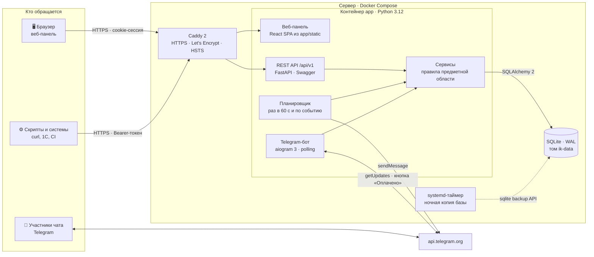
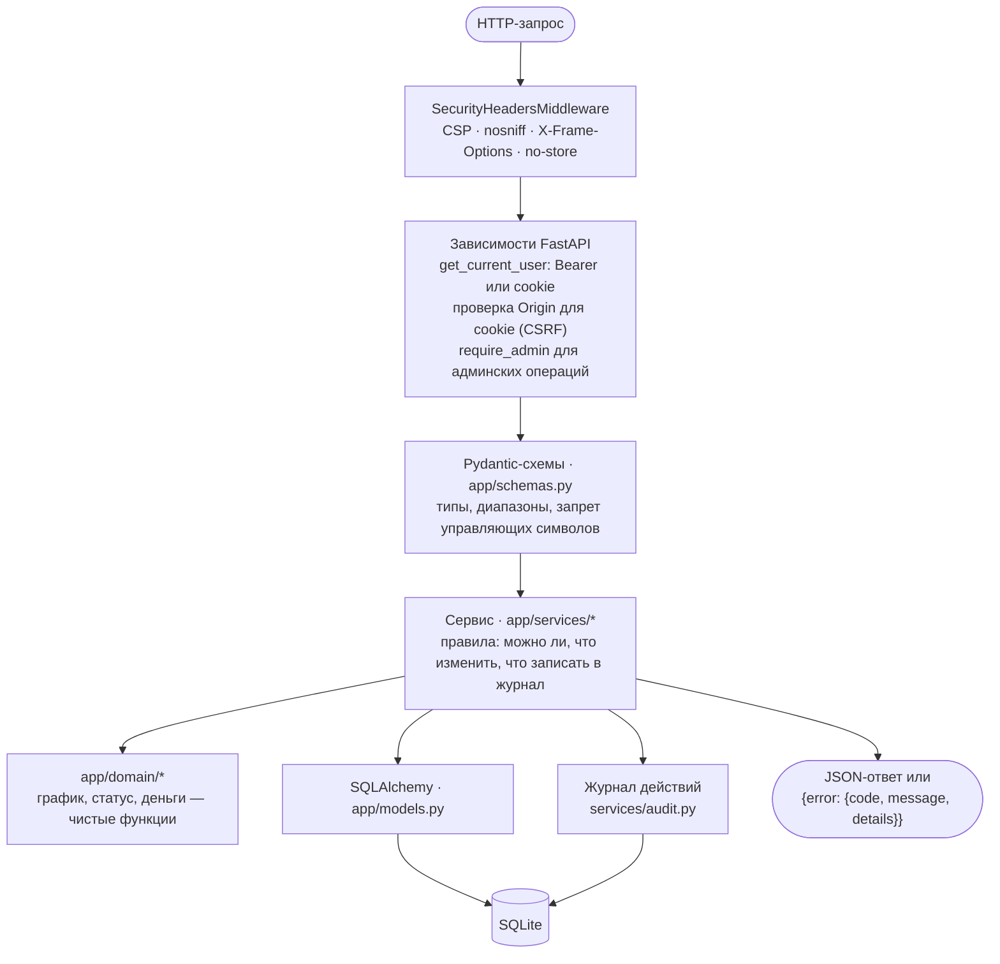
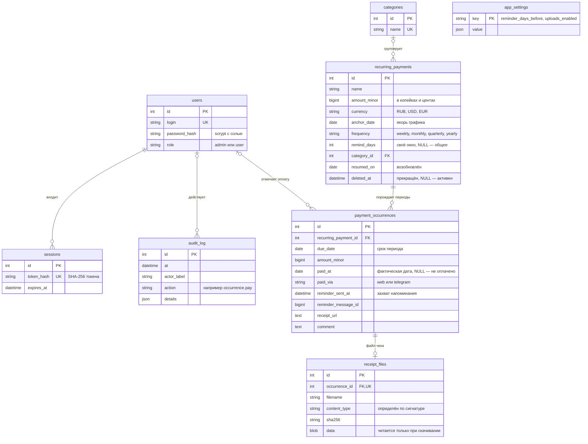
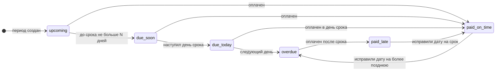
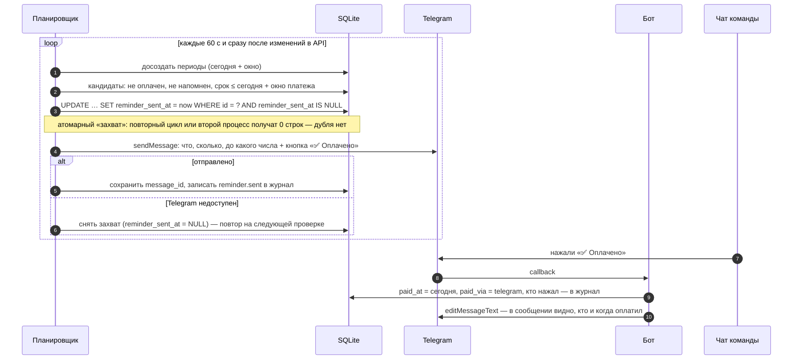
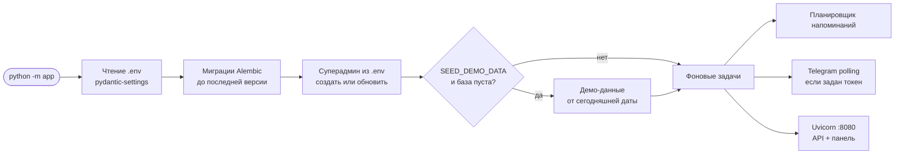
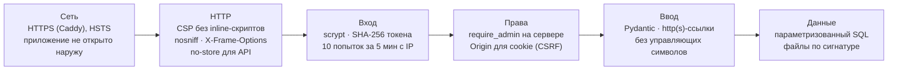

# Архитектура Invoice Keeper

> Как устроена система, из чего она собрана и почему решения приняты именно так.
> Развёртывание — в [DEPLOY.md](DEPLOY.md), справочник API — в [API.md](API.md).

## Содержание

1. [Карта системы](#1-карта-системы)
2. [Стек](#2-стек)
3. [Путь запроса через слои](#3-путь-запроса-через-слои)
4. [Модель данных](#4-модель-данных)
5. [Жизненный цикл периода](#5-жизненный-цикл-периода)
6. [Как работают напоминания](#6-как-работают-напоминания)
7. [Запуск приложения](#7-запуск-приложения)
8. [Ключевые решения](#8-ключевые-решения)
9. [Безопасность по слоям](#9-безопасность-по-слоям)
10. [Структура репозитория](#10-структура-репозитория)

---

## 1. Карта системы

Вся логика — в **одном процессе** `app`: REST API, веб-панель, планировщик напоминаний и Telegram-бот.
Снаружи на сервере стоит только Caddy (HTTPS). Данные — в одном файле SQLite на Docker-томе.



| Компонент | Что делает | Где в коде |
|---|---|---|
| Веб-панель | Главная, платежи, регулярные платежи, календарь и бюджет, пользователи, журнал, настройки | [`web/src`](../web/src), сборка — [`app/static`](../app/static) |
| REST API | 33 операции под `/api/v1`, авторизация, проверка прав, валидация, единый формат ошибок | [`app/api`](../app/api) |
| Сервисы | График, периоды, оплаты, напоминания, итоги, категории, файлы чеков, журнал | [`app/services`](../app/services) |
| Предметная логика | Чистые функции без БД: сроки по графику, статус периода, деньги | [`app/domain`](../app/domain) |
| Планировщик | Досоздаёт периоды и отправляет напоминания без дублей | [`app/services/reminders.py`](../app/services/reminders.py) |
| Telegram-бот | Кнопка «✅ Оплачено», `/upcoming`, `/chatid`, `/help` | [`app/telegram`](../app/telegram) |
| Caddy | HTTPS-сертификат, редирект с 80 на 443, приложение наружу не открывается | [`deploy/Caddyfile`](../deploy/Caddyfile) |

---

## 2. Стек

### Сервер

| Слой | Технология | Зачем именно она |
|---|---|---|
| Язык | **Python 3.12** | зрелая экосистема, `zoneinfo`, `StrEnum`, строгая типизация |
| HTTP и API | **FastAPI** + **Uvicorn** | OpenAPI и Swagger строятся из кода, зависимости для прав, async для потоковой загрузки файлов |
| Схемы и валидация | **Pydantic 2**, pydantic-settings | одна схема = проверка входа + документация + типы фронтенда; настройки из `.env` с понятными ошибками |
| База и ORM | **SQLite** (WAL) + **SQLAlchemy 2.0** | один файл, ноль администрирования, параметризованные запросы; `DATABASE_URL` позволяет перейти на PostgreSQL |
| Миграции | **Alembic** | применяются автоматически при старте; проверены тестом на сохранность истории |
| Telegram | **aiogram 3** | асинхронный бот в том же процессе, inline-кнопки, редактирование отправленных сообщений |
| Даты | **python-dateutil**, **tzdata** | `relativedelta` для «31-е → последний день месяца», единый часовой пояс `APP_TIMEZONE` |
| Пароли | `hashlib.scrypt` (стандартная библиотека) | без внешних зависимостей, соль на каждый пароль |

### Веб-панель

| Слой | Технология | Зачем |
|---|---|---|
| UI | **React 19** + **Mantine 9** | готовые доступные компоненты, тёмная и светлая темы, даты и модальные окна |
| Данные | **TanStack Query 5** | кеш, повторные запросы, согласованное обновление экранов после изменений |
| Клиент API | **openapi-fetch** + **openapi-typescript** | типы генерируются из `openapi.yaml` — фронтенд не разойдётся с API |
| Сборка | **Vite 8**, TypeScript 5 | сборка в `app/static`, на сервере Node.js не нужен |
| Шрифты и иконки | Inter, Exo 2 (self-hosted), Tabler Icons | без внешних CDN — строгая CSP |

### Инфраструктура

| Что | Технология |
|---|---|
| Контейнеры | Docker, Docker Compose v2 (образ `python:3.12-slim`, процесс не от root, healthcheck) |
| HTTPS | Caddy 2: сертификат Let's Encrypt для своего домена или `IP.sslip.io` |
| Развёртывание кодом | Ansible (роль `invoice_keeper`), идемпотентно, секреты в Ansible Vault |
| Ручная установка | самораспаковывающийся установщик `.run` с мастером настройки и командой `invoice-keeper` |
| Резервные копии | systemd-таймер, `sqlite3.backup`, ротация 7 ежедневных + 4 еженедельных, проверка целостности |
| Тесты | pytest + TestClient: 99 тестов (правила дат, права, API, напоминания, безопасность, миграции) |

---

## 3. Путь запроса через слои



* **Права проверяются на сервере.** Интерфейс лишь скрывает кнопки; без входа любой эндпоинт (кроме входа
  и документации) отвечает `401`, пользователь на админских — `403`. Тест перебирает все операции из OpenAPI.
* **Ошибки — одним форматом** (`app/errors.py`): код для программ, сообщение для людей, подробности для валидации.
* **Изменения пишутся в журнал** в той же транзакции, что и сами изменения.

---

## 4. Модель данных



**Главная идея:** регулярный платёж — это шаблон, а **период** (`payment_occurrences`) — отдельная запись
со своим сроком, своей отметкой об оплате, фактической датой и напоминанием. Пара «платёж + срок» уникальна,
поэтому период не может появиться дважды. Новый период не стирает прошлые, просрочка не останавливает следующие.

---

## 5. Жизненный цикл периода

Статус **не хранится, а вычисляется** из срока, фактической даты и сегодняшнего дня
([`app/domain/occurrence_state.py`](../app/domain/occurrence_state.py)). Поэтому исправление даты оплаты
сразу пересчитывает просрочку, и ничего не может «рассинхронизироваться».



| Статус | Когда |
|---|---|
| `upcoming` | не оплачен, до срока больше окна напоминания |
| `due_soon` | не оплачен, до срока ≤ N дней (N — своё окно платежа или общее, по умолчанию 3) |
| `due_today` | не оплачен, срок сегодня |
| `overdue` | не оплачен, срок прошёл (просрочка — со следующего дня после срока) |
| `paid_on_time` | оплачен в день срока или раньше |
| `paid_late` | оплачен позже срока, в ответе есть `overdue_days` |

**Какие периоды существуют.** Генератор держит все периоды со сроком не позже «сегодня + окно напоминания»
и ещё один следующий (если он оплачен заранее — ещё один). Сроки считаются **от якоря**, а не от прошлого
срока: якорь 31 января → 28/29 февраля → **31 марта**. Дальние сроки календарь и бюджет достраивают на лету
как «плановые» (`status: planned` в `/payments/forecast`), не создавая записей в базе.

---

## 6. Как работают напоминания



* **Один раз на период.** Оплаченный период не напоминается; после оплаты следующий период напомнится в своё окно.
* **Сразу, если поздно.** Добавили платёж за 1 день до срока — напоминание уходит в ближайшую секунду.
* **Одним сообщением.** Платёж завели задним числом и у него несколько неоплаченных периодов — придёт одно сообщение.
* **Окно настраивается.** Общее — в «Настройках» (`PATCH /settings`), своё — в карточке платежа (`remind_days`),
  от 3 до 365 дней. Окно увеличили — попавшие в него сроки напомнятся при ближайшей проверке.
* **Оплатили в панели** — бот обновляет уже отправленное сообщение.

---

## 7. Запуск приложения



CLI: `python -m app` (сервер), `python -m app reset-db [--empty]` (пересоздать базу),
`python -m app export-openapi` (обновить `openapi.yaml`).

---

## 8. Ключевые решения

| Решение | Почему так | От чего отказались |
|---|---|---|
| **Один процесс** на API, бота и планировщик | Один контейнер, одна точка истины, нечего синхронизировать. Каждый сервер — независимый экземпляр со своим ботом | Celery + Redis + отдельный воркер: лишняя инфраструктура для десятков платежей |
| **SQLite в режиме WAL** | Один файл: копия — одной командой, перенос — одним архивом. Читатели не блокируют запись | PostgreSQL по умолчанию. Код готов к нему (`DATABASE_URL`, `ON CONFLICT` для обоих диалектов) |
| **Период — отдельная запись** | У каждого месяца своя оплата, дата, чек и напоминание; история не теряется при изменениях | Флаг «оплачено» на самом платеже: теряется прошлое, нельзя исправить дату за конкретный месяц |
| **Статус вычисляется** | Исправили дату — просрочка пересчиталась; нет фоновых задач «пометить просроченным» | Поле `is_overdue` в БД, которое нужно обновлять по расписанию |
| **Сроки от якоря** | `n`-й срок = якорь + n месяцев: 31-е число не «съезжает» на 28-е навсегда | Срок = прошлый срок + месяц |
| **Окно периодов, а не годы вперёд** | Правка графика пересоздаёт лишь несколько будущих периодов; календарь достраивает плановые сроки | Генерировать периоды на год: тяжёлые правки, «мусорные» строки |
| **Атомарный захват напоминания** | `UPDATE … WHERE reminder_sent_at IS NULL` — дубль невозможен ни при повторе, ни при перезапуске | Флаг после отправки: при сбое между отправкой и записью — повтор сообщения |
| **Деньги — целые копейки** | `BigInteger` в базе, `Decimal` строкой в API: никаких ошибок `float` | `float` и округления |
| **Валюты отдельно** | RUB, USD и EUR не складываются и не конвертируются — так требует учёт | Пересчёт по курсу |
| **Суперадмин только в `.env`** | Нельзя «потерять» администратора или повысить права через API; смена пароля — правка `.env` | Регистрация админов через панель |
| **Файлы чеков в базе** | Попадают в резервные копии и переносятся вместе с базой; на диске нет пользовательских файлов | Папка `uploads/` рядом с приложением |
| **Тип файла по сигнатуре** | Программа, переименованная в `.pdf`, не пройдёт; PDF со скриптами отклоняется | Доверять расширению или `Content-Type` от браузера |
| **Миграции без batch-режима** | В SQLite batch пересоздаёт таблицу, и каскад удалил бы периоды. Это ловит отдельный тест | Автосгенерированные миграции «как есть» |
| **Типы фронтенда из OpenAPI** | Изменили схему — TypeScript покажет все места, которые нужно поправить | Ручные интерфейсы |
| **Собранная панель в репозитории** | На сервере не нужен Node.js, сборка образа — секунды | Сборка фронтенда в Docker |
| **Журнал только дописывается** | Кто, что, когда и с какого IP — для разбора спорных оплат | Редактируемая история |

---

## 9. Безопасность по слоям



Подробности и тесты — в разделе «Безопасность» [README](../README.md#безопасность).

---

## 10. Структура репозитория

```text
app/
  main.py, __main__.py   приложение, запуск фоновых задач, CLI: serve / reset-db / export-openapi
  config.py              настройки из .env (pydantic-settings)
  container.py           сборка зависимостей: база, часы, бот, планировщик (подменяются в тестах)
  middleware.py          заголовки безопасности
  models.py, db.py       таблицы SQLAlchemy, настройки SQLite (WAL, внешние ключи)
  schemas.py             схемы запросов и ответов — они же OpenAPI
  domain/                чистая логика: schedule (график), occurrence_state (статус), money, reminders
  services/              правила: recurring, occurrences, reminders, summary, forecast, categories,
                         receipts, app_settings, users, auth, audit
  api/                   эндпоинты: auth, payments, categories, settings, users, audit
  telegram/              бот и тексты сообщений
  seed.py                демо-данные от сегодняшней даты
  static/                собранная веб-панель
migrations/versions/     миграции Alembic (0001 — схема, 0002 — окна и возобновление, 0003 — категории и чеки)
tests/                   pytest
web/src/                 исходники панели: pages/, components/, api/ (типы из OpenAPI), theme.ts
deploy/Caddyfile         HTTPS-прокси
ansible/                 роль развёртывания
installer/, deploy-kit/  установщик одним файлом и руководство администратора
docs/                    эта документация
```
