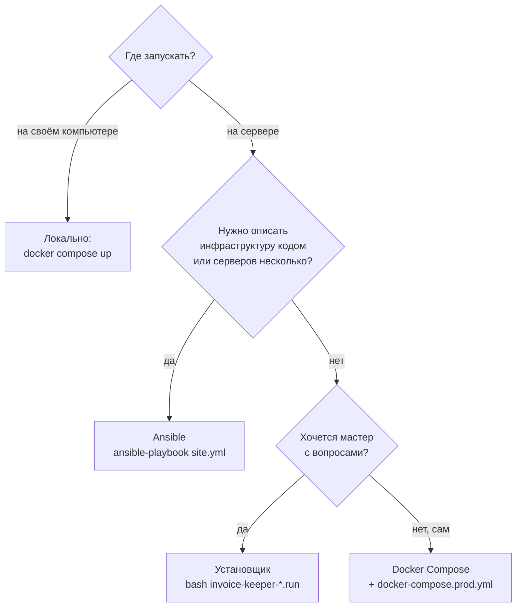
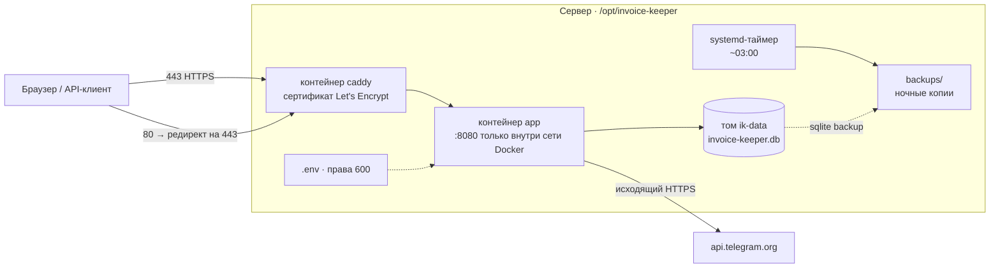
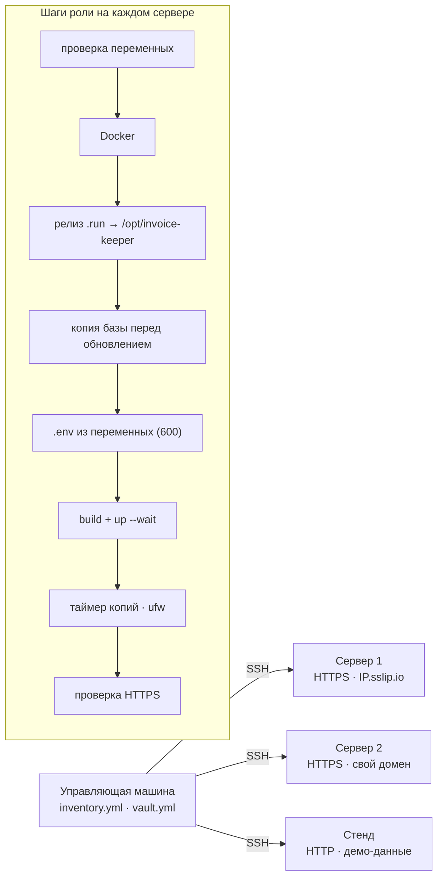
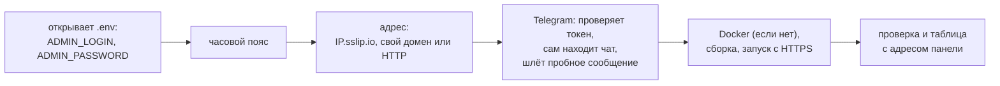

# Развёртывание Invoice Keeper

> Пошаговое руководство: от проверки на своём компьютере до HTTPS-сервера, обновлений и переноса.
> Устройство системы — в [ARCHITECTURE.md](ARCHITECTURE.md), справочник API — в [API.md](API.md).

## Содержание

1. [Какой способ выбрать](#1-какой-способ-выбрать)
2. [Что получится на сервере](#2-что-получится-на-сервере)
3. [Подготовка](#3-подготовка)
4. [Локальный запуск](#4-локальный-запуск)
5. [Ansible — инфраструктура кодом](#5-ansible--инфраструктура-кодом)
6. [Установщик одним файлом](#6-установщик-одним-файлом)
7. [Docker Compose вручную](#7-docker-compose-вручную)
8. [Проверка после установки](#8-проверка-после-установки)
9. [Обновление](#9-обновление)
10. [Резервные копии и перенос](#10-резервные-копии-и-перенос)
11. [Журналы и состояние](#11-журналы-и-состояние)
12. [Безопасность на сервере](#12-безопасность-на-сервере)
13. [Решение проблем](#13-решение-проблем)

---

## 1. Какой способ выбрать

| Способ | Для чего | Что нужно | Время |
|---|---|---|---|
| [Локально](#4-локальный-запуск) | посмотреть и проверить | Docker **или** Python 3.12 | 1 мин |
| [**Ansible**](#5-ansible--инфраструктура-кодом) | серверы, повторяемые раскатки, несколько экземпляров | управляющая машина с Ansible, SSH к серверам | 3–4 мин на чистый сервер, ~20 с повторно |
| [Установщик `.run`](#6-установщик-одним-файлом) | один сервер, руками, с мастером в терминале | SSH под root | 2–3 мин |
| [Docker Compose](#7-docker-compose-вручную) | полный контроль, свой процесс деплоя | Docker на сервере, git | 5 мин |



Результат у всех серверных способов одинаковый: Docker, HTTPS через Caddy, база на Docker-томе.
У Ansible и установщика есть ещё команда управления `invoice-keeper` и ночные копии.

> **Суперадмин задаётся только в `.env`** (`ADMIN_LOGIN`, `ADMIN_PASSWORD`). Приложение создаёт его при запуске,
> через панель и API его не изменить и не удалить. Сменить пароль — поменять `.env` и перезапустить.

---

## 2. Что получится на сервере



| Где | Что там |
|---|---|
| `/opt/invoice-keeper/` | файлы версии, `docker-compose*.yml`, `deploy/Caddyfile`, `VERSION` |
| `/opt/invoice-keeper/.env` | настройки и секреты, права `600` |
| `/opt/invoice-keeper/backups/` | резервные копии базы, права `700` |
| Docker-том `invoice-keeper_ik-data` | база SQLite, **включая файлы чеков** |
| `/usr/local/bin/invoice-keeper` | команда управления (Ansible и установщик) |
| порты | 80 и 443 наружу (Caddy); 8080 — только внутри Docker |

---

## 3. Подготовка

### 3.1. Сервер

| Что | Требование |
|---|---|
| Система | Ubuntu 22.04 / 24.04 / 26.04 (проверено на 26.04); Debian 12 — Docker ставится из его репозитория |
| Ресурсы | 1 vCPU, 1 ГБ RAM, 5 ГБ диска — с запасом для приложения, Caddy и копий |
| Доступ | SSH под `root` или пользователем с `sudo` |
| Сеть наружу | Docker Hub (`python`, `caddy`), PyPI (зависимости при сборке), Let's Encrypt, `api.telegram.org` |
| Порты | для HTTPS свободны **80 и 443**, в панели хостинга они открыты |

### 3.2. Адрес

* **Без домена:** используйте `IP.sslip.io` (например, `203.0.113.10.sslip.io`) — это бесплатный DNS, который
  указывает на ваш IP. Caddy получит для него настоящий сертификат. Ansible и установщик подставляют его сами.
* **Свой домен:** A-запись `pay.example.ru → IP сервера` должна быть создана до установки.

### 3.3. Telegram-бот (5 минут)

1. Напишите [@BotFather](https://t.me/BotFather) → `/newbot` → скопируйте токен вида `1234567890:AAH…`.
2. Создайте группу команды и добавьте туда бота.
3. ID чата: после запуска приложения отправьте в группе `/chatid` — бот ответит числом (у групп оно
   отрицательное, `-100…`). Установщик находит чат сам.

> **У каждого сервера — свой бот.** Один токен нельзя одновременно запускать в двух местах: второй экземпляр
> получит ошибку `Conflict: terminated by other getUpdates request`. Для локальной проверки заведите отдельного
> бота или поставьте `TELEGRAM_POLLING=false`.

Без токена приложение работает полностью, просто не отправляет напоминания.

---

## 4. Локальный запуск

### Docker (одна команда)

```bash
cp .env.example .env
docker compose up -d --build
```

* Панель: **http://localhost:8080** · Swagger: **http://localhost:8080/api/v1/docs**
* Вход: `admin` / пароль из `ADMIN_PASSWORD` (в примере — `change-me`), демо-пользователи `user` / `user12345`
  и `accountant` / `accountant123`.

### Python без Docker

Нужен Python **3.12 или новее** (проверено на 3.12, 3.13, 3.14); Node.js не нужен — собранная панель уже
лежит в `app/static`. Подробно, с установкой Python, — в [README](../README.md#вариант-2-python-без-docker).

Windows (PowerShell):

```powershell
Copy-Item .env.example .env
py -m venv .venv
.venv\Scripts\python -m pip install -r requirements.txt
.venv\Scripts\python -m app
```

Linux и macOS:

```bash
cp .env.example .env
python3 -m venv .venv
.venv/bin/python -m pip install -r requirements.txt
.venv/bin/python -m app
```

При первом запуске создаётся `data/invoice-keeper.db`, применяются миграции, создаётся суперадмин из `.env`
и загружаются демо-данные (от сегодняшней даты — сценарий проверки работает в любой день).

| Задача | Команда |
|---|---|
| вернуть демо-данные | `python -m app reset-db` (Docker: `docker compose exec app python -m app reset-db`) |
| пустая база | `python -m app reset-db --empty` |
| остановить | `Ctrl+C` или `docker compose down` (данные остаются в томе) |

---

## 5. Ansible — инфраструктура кодом

> 🧭 **Пошаговый гайд для новичка** — установка Ansible на Windows, macOS и Linux, ключ SSH, готовые файлы
> для копирования, Telegram и разбор ошибок: [**ansible/README.md**](../ansible/README.md).

Роль [`ansible/roles/invoice_keeper`](../ansible/roles/invoice_keeper) описывает сервер целиком: ставит Docker,
раскладывает релиз, генерирует `.env` из переменных, запускает с HTTPS, включает ночные копии и проверяет, что
панель открывается. **Каждый хост в inventory — независимый экземпляр** со своей базой и своим ботом.
Повторный прогон без изменений ничего не трогает (`changed=0`).



### 5.1. Требования

* Управляющая машина: Linux, macOS или **WSL** в Windows; `ansible-core` 2.15+ (проверено на 2.21).
* SSH-ключ к серверам: `ssh-keygen -t ed25519`, затем `ssh-copy-id root@IP`.

> **Windows:** работайте в WSL из домашней папки (`cp -r /mnt/d/…/ansible /mnt/d/…/deploy-kit ~/invoice-keeper/`).
> Из `/mnt/c`, `/mnt/d` Ansible игнорирует `ansible.cfg` — эти папки доступны всем на запись.

### 5.2. Пошагово

```bash
cd ansible
ansible-galaxy collection install -r requirements.yml       # community.docker, community.general

cp inventory.example.yml inventory.yml                       # 1. серверы
cp group_vars/invoice_keeper/vault.yml.example group_vars/invoice_keeper/vault.yml
nano group_vars/invoice_keeper/vault.yml                     # 2. пароль суперадмина, токены ботов
ansible-vault encrypt group_vars/invoice_keeper/vault.yml    # 3. зашифровать

(cd .. && scripts/build-installer.sh)                        # 4. свежий релиз в deploy-kit/
ansible-playbook site.yml --ask-vault-pass                   # 5. развернуть
```

> Релиз — это файл `deploy-kit/invoice-keeper-<версия>.run`. Роль берёт из него код приложения, поэтому после
> изменений в коде пересоберите его из корня репозитория: `scripts/build-installer.sh`.

**Минимальный inventory** — один сервер, HTTPS на `IP.sslip.io`:

```yaml
invoice_keeper:
  hosts:
    ik-1:
      ansible_host: 203.0.113.10
      ansible_user: root
      ik_admin_login: owner
      ik_admin_password: "{{ vault_ik_admin_password }}"
```

**Полный пример** — три сервера с разными режимами:

```yaml
invoice_keeper:
  vars:
    ansible_user: root
    ik_timezone: Europe/Moscow
    ik_admin_login: owner
    ik_admin_password: "{{ vault_ik_admin_password }}"
  hosts:
    ik-prod-1:                      # HTTPS на IP.sslip.io
      ansible_host: 203.0.113.10
      ik_telegram_bot_token: "{{ vault_ik_prod_1_bot_token }}"
      ik_telegram_chat_id: "-1001234567890"
    ik-prod-2:                      # HTTPS на своём домене
      ansible_host: 203.0.113.20
      ik_domain: pay.example.ru
      ik_telegram_bot_token: "{{ vault_ik_prod_2_bot_token }}"
      ik_telegram_chat_id: "-1009876543210"
    ik-demo:                        # HTTP на порту 8081, демо-данные
      ansible_host: 203.0.113.30
      ik_access_mode: http
      ik_http_port: 8081
      ik_seed_demo_data: true
      ik_demo_user_password: "{{ vault_ik_demo_password }}"
      ik_demo_accountant_password: "{{ vault_ik_demo_password }}"
```

В конце прогона для каждого сервера выводятся адрес панели, Swagger, логин суперадмина и состояние Telegram.
Пароли не выводятся.

> **ID чата можно указать позже.** Раскатайте с одним токеном — бот запустится и ответит на `/chatid` в группе.
> Впишите число в `ik_telegram_chat_id` и запустите плейбук ещё раз.

### 5.3. Главные переменные

| Переменная | По умолчанию | Назначение |
|---|---|---|
| `ik_admin_login` / `ik_admin_password` | `admin` / — | суперадмин; пароль **обязателен**, от 8 символов, хранится в Vault |
| `ik_access_mode` | `https` | `https` — Caddy + Let's Encrypt; `http` — без шифрования |
| `ik_domain` | `<IP>.sslip.io` | домен для HTTPS |
| `ik_http_port` | `80` | порт в режиме `http` |
| `ik_timezone` | `Europe/Moscow` | часовой пояс сроков и напоминаний |
| `ik_telegram_bot_token` / `ik_telegram_chat_id` | — | бот и чат; у каждого сервера свой бот |
| `ik_telegram_proxy` | — | `socks5://…` или `http://…`, если Telegram недоступен напрямую |
| `ik_reminder_days_before` | `3` | окно напоминания по умолчанию (3–365); дальше меняется в панели |
| `ik_upload_max_mb` | `10` | предельный размер файла чека (1–50 МБ) |
| `ik_seed_demo_data` | `false` | демо-данные в пустую базу (тогда нужны `ik_demo_*_password`) |
| `ik_backups` / `ik_backup_time` | `true` / `03:00` | ночные копии |
| `ik_env_extra` | `{}` | любые строки `.env`, например `{ LOG_LEVEL: DEBUG }` |

Все переменные с комментариями: [`defaults/main.yml`](../ansible/roles/invoice_keeper/defaults/main.yml),
справочник роли: [`ansible/REFERENCE.md`](../ansible/REFERENCE.md).

### 5.4. Типовые операции

```bash
ansible invoice_keeper -m ping --ask-vault-pass                          # связь с серверами
ansible-playbook site.yml --ask-vault-pass --check --diff                # что изменится, ничего не меняя
ansible-playbook site.yml --ask-vault-pass --limit ik-new                # только новый сервер
ansible-playbook site.yml --ask-vault-pass --tags config,service         # только .env и перезапуск
ansible-vault edit group_vars/invoice_keeper/vault.yml                   # сменить пароль или токен
```

Теги: `docker`, `release`, `config`/`service`, `backups`, `firewall`, `verify`.

> Не правьте `.env` на сервере руками: следующий прогон перезапишет его из переменных.

---

## 6. Установщик одним файлом

`deploy-kit/invoice-keeper-<версия>.run` — приложение и мастер настройки в одном файле. Подробное руководство
администратора (16 разделов): [`deploy-kit/README.md`](../deploy-kit/README.md).

```bash
# на своём компьютере
scp deploy-kit/invoice-keeper-1.6.0.run root@IP_СЕРВЕРА:
ssh root@IP_СЕРВЕРА

# на сервере
bash invoice-keeper-1.6.0.run
```

Что делает мастер:



**Без вопросов** (для скриптов) — заранее заполненный `.env` и флаг `--yes`:

```bash
mkdir -p /opt/invoice-keeper
cat > /opt/invoice-keeper/.env <<'EOF'
ADMIN_LOGIN=owner
ADMIN_PASSWORD='Надёжный-пароль-1'
APP_TIMEZONE=Europe/Moscow
TELEGRAM_BOT_TOKEN=1234567890:AAH…
TELEGRAM_CHAT_ID=-1001234567890
EOF
chmod 600 /opt/invoice-keeper/.env
bash invoice-keeper-1.6.0.run --yes
```

Параметры: `--yes`, `--reconfigure`, `--import АРХИВ`, `--plain` (без анимации), `--extract ПАПКА`, `--version`, `--help`.

### Команда `invoice-keeper`

| Команда | Что делает |
|---|---|
| `status` · `info` · `version` | состояние контейнеров и проверка адреса · адрес, версия, Telegram · версия |
| `logs` · `logs caddy` | журнал приложения · журнал HTTPS (сертификат) |
| `start` · `stop` · `restart` | управление; `restart` применяет изменения `.env` |
| `config` | мастер настройки с текущими значениями |
| `backup` · `backups` · `restore ФАЙЛ\|latest` | копия сейчас · список копий · восстановление |
| `export` · `import ФАЙЛ` | зашифрованный архив для переноса (база + настройки) |
| `reset-demo [--empty]` | пересоздать базу (текущая сначала сохраняется) |
| `uninstall [--purge]` | удалить контейнеры (`--purge` — вместе с данными и копиями) |

---

## 7. Docker Compose вручную

```bash
git clone <репозиторий> invoice-keeper && cd invoice-keeper
cp .env.example .env
nano .env
```

Обязательно в `.env` для сервера:

```dotenv
ADMIN_LOGIN=owner
ADMIN_PASSWORD='надёжный-пароль'
DOMAIN=203.0.113.10.sslip.io          # или свой домен
COOKIE_SECURE=true                    # cookie только по HTTPS
SEED_DEMO_DATA=false                  # или свои DEMO_USER_PASSWORD / DEMO_ACCOUNTANT_PASSWORD
TELEGRAM_BOT_TOKEN=1234567890:AAH…
TELEGRAM_CHAT_ID=-1001234567890
```

Запуск с HTTPS:

```bash
docker compose -f docker-compose.yml -f docker-compose.prod.yml up -d --build
```

| Файл | Что добавляет |
|---|---|
| `docker-compose.yml` | контейнер `app`, том `ik-data`, порт 8080, ротация журнала |
| `docker-compose.prod.yml` | контейнер `caddy` на 80/443, `app` наружу не публикуется |
| `docker-compose.ipv6.yml` | IPv6 в сети контейнеров — если Telegram с сервера доступен только по IPv6 (Docker 27+) |

Чтобы не писать `-f` каждый раз, добавьте в `.env`:
`COMPOSE_FILE=docker-compose.yml:docker-compose.prod.yml`.

> **Кавычки в `.env`.** Docker Compose подставляет переменные вместо `$` и отрезает ` #комментарий`.
> Если в пароле или токене есть `$`, `#` или пробел — берите значение в одинарные кавычки: `ADMIN_PASSWORD='Pa$s #1'`.

---

## 8. Проверка после установки

```bash
# 1. приложение отвечает и отдаёт спецификацию
curl -fsS https://ДОМЕН/api/v1/openapi.json | head -c 80; echo

# 2. вход работает (токен в ответе)
curl -fsS -X POST https://ДОМЕН/api/v1/auth/login \
  -H 'Content-Type: application/json' -d '{"login":"owner","password":"…"}'

# 3. заголовки безопасности на месте
curl -sI https://ДОМЕН/ | grep -Ei 'strict-transport|content-security|x-frame'
```

Чек-лист:

- [ ] панель открывается по `https://…`, замок в браузере без предупреждений;
- [ ] вход суперадмином работает, демо-пароли (если демо включено) заменены своими;
- [ ] в группе Telegram команда `/chatid` отвечает числом; на главной нет предупреждения «Telegram не настроен»;
- [ ] пробный платёж со сроком через 1–2 дня → напоминание пришло в чат в течение минуты;
- [ ] кнопка «✅ Оплачено» в сообщении отмечает оплату, сообщение обновилось;
- [ ] `invoice-keeper backups` показывает время следующей ночной копии (Ansible и установщик).

---

## 9. Обновление

**Миграции базы применяются автоматически** при запуске новой версии. Они проверены тестом на то, что история
оплат сохраняется.

| Способ | Как обновить |
|---|---|
| Ansible | пересобрать релиз (`scripts/build-installer.sh`) → `ansible-playbook site.yml --ask-vault-pass`. Перед обновлением роль сама сохраняет копию `before-update-…` |
| Установщик | скопировать новый `.run` на сервер → `bash invoice-keeper-НОВАЯ.run`. Настройки и данные сохраняются, копия делается автоматически |
| Docker Compose | `git pull` → `docker compose up -d --build`. **Сначала сделайте копию** (раздел 10) |

Откат (Ansible): указать прошлый релиз и восстановить копию перед обновлением:

```bash
ansible-playbook site.yml --ask-vault-pass --limit ik-1 -e ik_release=/путь/invoice-keeper-СТАРАЯ.run
ssh root@203.0.113.10 invoice-keeper restore /opt/invoice-keeper/backups/before-update-ДАТА.db.gz
```

---

## 10. Резервные копии и перенос

**Всё в одном файле базы** — платежи, оплаты, журнал, настройки и **файлы чеков** (они хранятся в базе).
Поэтому копия базы — это полная копия данных.

| Что | Как |
|---|---|
| Автоматически | каждую ночь (~03:00), хранятся 7 ежедневных и 4 еженедельных, каждая проверяется `PRAGMA integrity_check` |
| Вручную | `invoice-keeper backup`, список — `invoice-keeper backups` |
| Восстановить | `invoice-keeper restore latest` или `restore ФАЙЛ` — текущая база сначала сохраняется |
| Перенести на другой сервер | `invoice-keeper export` → архив `.ikb` (база + `.env`, AES-256) → на новом сервере `bash invoice-keeper-*.run --import архив.ikb` |

**Docker Compose без установщика** — копия «на горячую» через SQLite backup API:

```bash
docker compose exec app python -c "import sqlite3; s=sqlite3.connect('/app/data/invoice-keeper.db'); d=sqlite3.connect('/app/data/backup.db'); s.backup(d); d.close()"
docker compose cp app:/app/data/backup.db ./invoice-keeper-$(date +%F).db
```

Храните копии и вне сервера: архив `export` можно скачать по `scp` (подробно — `deploy-kit/README.md`, раздел 10.4).

---

## 11. Журналы и состояние

| Что посмотреть | Команда |
|---|---|
| состояние и проверка адреса | `invoice-keeper status` |
| журнал приложения в реальном времени | `invoice-keeper logs` (Compose: `docker compose logs -f app`) |
| сертификат и входящие запросы | `invoice-keeper logs caddy` |
| здоровье контейнера | `docker ps` → колонка `STATUS` (`healthy`): Docker раз в 30 с запрашивает `/api/v1/openapi.json` |
| действия людей и бота | панель → «Журнал действий» (входы, оплаты, напоминания, чеки, настройки) |

---

## 12. Безопасность на сервере

- [ ] **Свой пароль суперадмина** (не `change-me`), `.env` с правами `600` — Ansible и установщик делают это сами.
- [ ] **Демо-данные выключены** (`SEED_DEMO_DATA=false`) или у демо-пользователей свои пароли.
- [ ] **`COOKIE_SECURE=true`** при HTTPS — Ansible и установщик выставляют автоматически.
- [ ] **Наружу открыты только 22, 80, 443**; порт 8080 не публикуется (`docker-compose.prod.yml`).
- [ ] **Свой бот на каждом сервере**; токен в Vault или в `.env`, не в git.
- [ ] **Загрузка файлов чеков** при необходимости отключается в панели: «Настройки» → «Файлы чеков».
- [ ] Копии хранятся и вне сервера (`invoice-keeper export`).

---

## 13. Решение проблем

| Симптом | Что делать |
|---|---|
| `ADMIN_PASSWORD: Field required` при старте | не задан пароль суперадмина в `.env` |
| `REMINDER_DAYS_BEFORE: …greater than or equal to 3` | окно напоминания — от 3 до 365 дней |
| сертификат не выпускается | закрыты 80/443 у хостинга или A-запись не указывает на сервер; `invoice-keeper logs caddy` |
| бот молчит, в журнале `Conflict: terminated by other getUpdates` | этот токен запущен ещё где-то — у каждого экземпляра свой бот |
| бот молчит, в журнале ошибки подключения к `api.telegram.org` | у сервера нет доступа к Telegram по IPv4: `docker-compose.ipv6.yml` (Ansible: `ik_ipv6: auto`) или `TELEGRAM_PROXY` |
| на главной «Telegram не настроен» | нет `TELEGRAM_CHAT_ID`: `/chatid` в группе → значение в `.env` → перезапуск |
| `401` на всех запросах API | нет заголовка `Authorization: Bearer <token>` или токен истёк (`SESSION_TTL_HOURS`) |
| файл чека не прикрепляется | `413` — больше `UPLOAD_MAX_MB`; `415` — формат не PDF/PNG/JPG/WebP или расширение не совпадает с содержимым; `403 uploads_disabled` — загрузка выключена в «Настройках» |
| пароль с `$` или `#` «не подходит» | возьмите значение в `.env` в одинарные кавычки |
| Ansible: `пароль суперадмина обязателен` | забыли `--ask-vault-pass` |
| Ansible: `Не найден релиз deploy-kit/invoice-keeper-*.run` | соберите: `scripts/build-installer.sh` |

Больше случаев: [`deploy-kit/README.md`](../deploy-kit/README.md) (раздел 14) и [`ansible/REFERENCE.md`](../ansible/REFERENCE.md) («Решение проблем»).
